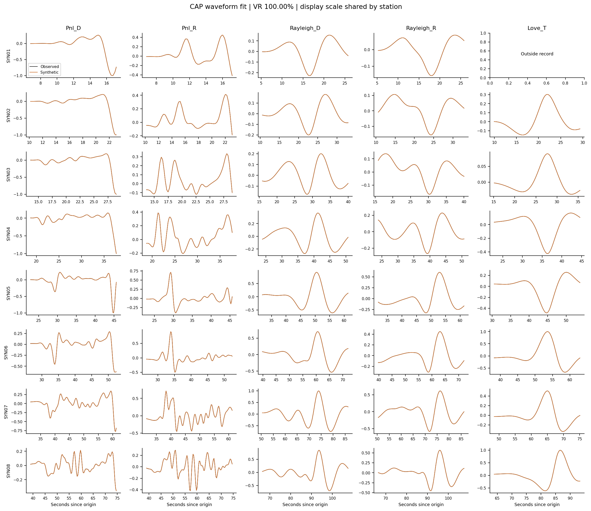

# SeismicX 震源机制联合反演

[English](README.md) · [简体中文](README.zh-CN.md) · [验证结果](docs/VALIDATION.zh-CN.md)

**DNN 多震相走时、走时梯度出射角、初动分类，以及 CAP＋初动联合双力偶震源机制反演。**

本私有仓库包含应用源码、训练完成的模型、固定速度模型定义和可以直接运行的合成示例。CSNDATA 原始记录、训练标签库、临时 Green 函数缓存和机器日志不进入版本管理。GRTM 求解器单独安装，本仓库不复制其实现源码。

## 1. 程序功能

| 模式 | 输入 | 输出 |
|---|---|---|
| `polarity` | 几何信息，以及原始 Z 窗口、连续 Z、人工 U/D 或 U 概率 | 等价双节面、归一化矩张量、极性不符数量、台站诊断和机制图 |
| `joint` | 上述初动信息，以及去仪器响应后的位移波形 | CAP＋初动联合机制、N m 矩张量、Mw、候选深度最优解、分组时移和波形拟合图 |
| `arrivals` | 震源深度、震中距、震相和面波周期 | DNN 走时、输入梯度、出射角、有效性，以及 Rayleigh/Love 群到时 |

**正式推理不导入 ObsPy/TauP。** 只有离线体波训练标签使用 TauP；面波训练标签由 GRTM 的 Rayleigh/Love 本征模态求解器提供。完整合成波形仍由物理 GRTM 计算，走时 DNN 不生成合成波形。

目前求解的是双力偶机制。两个节面是等价表示，不能只比较一个走向/倾角/滑动角三元组判断结果是否不同；本程序尚未提供任意六分量矩张量的 ISO/CLVD 分解反演。

## 2. 安装

### 已验证环境

记录的验证环境为 Linux/WSL、Python 3.13、PyTorch 2.8.0＋CUDA 12.8、GRTM **0.6.0.dev12**、两张 RTX 5090。DNN 推理和初动求解也有 CPU 路径。此联合程序不选择 MPS 后端。

GRTM dev12 提供 Linux x86_64 / CPython 3.13 / glibc >=2.31 和 macOS arm64 / CPython 3.12 的原生 wheel。Linux CUDA 二进制面向 SM120；有对应 wheel 不代表本联合应用已在所有平台完成验证。

### 克隆并准备 Python 环境

需要使用有权限访问私有仓库的 GitHub 账户：

```bash
gh repo clone cangyeone/seismicx-focal-mechanism
cd seismicx-focal-mechanism
python3.13 -m venv .venv
source .venv/bin/activate
python -m pip install --upgrade pip
```

安装适合设备的 PyTorch。以下命令对应已记录的 CUDA 环境：

```bash
python -m pip install torch==2.8.0 --index-url https://download.pytorch.org/whl/cu128
python -m pip install numpy scipy matplotlib
```

仅 CPU 环境改用匹配的 CPU 版 PyTorch。Apple Silicon 使用 Python 3.12、对应的 GRTM wheel，并选择 `--device cpu`。

### 安装 GRTM 预览版

不要用旧的稳定版 0.5.x 替代这里要求的预览接口：

```bash
# Linux/WSL x86_64，CPython 3.13：
python -m pip install 'https://github.com/cangyeone/seismicx-grtm-community/releases/download/v0.6.0.dev12/seismicx_grtm-0.6.0.dev12-cp313-cp313-manylinux_2_31_x86_64.whl'

# macOS arm64，CPython 3.12；使用这一条替代上面的 Linux wheel：
# python -m pip install 'https://github.com/cangyeone/seismicx-grtm-community/releases/download/v0.6.0.dev12/seismicx_grtm-0.6.0.dev12-cp312-cp312-macosx_11_0_arm64.whl'
```

下载文件校验值和上游说明见 [GRTM dev12 发布页](https://github.com/cangyeone/seismicx-grtm-community/releases/tag/v0.6.0.dev12)。

### 安装本程序并检查模型

```bash
python -m pip install -e . --no-deps
python scripts/verify_assets.py
seismic-joint --help
```

这里使用**可编辑安装**，请保留仓库及 `assets/`：模型文件位于 Python 包旁边。当前没有提供内嵌全部模型的独立应用 wheel。`--no-deps` 假定前面依赖已安装，避免替换成不兼容的 GRTM。

也可在仓库内直接用 `python -m seismic_joint ...`。`run_cuda.sh` 默认调用当前环境的 `python3`；可通过 `SEISMIC_JOINT_PYTHON` 指定解释器。

## 3. 快速开始

以下命令在仓库根目录、已激活的 Python 环境中运行。第二张卡使用 `cuda:1`；CPU 使用 `cpu`。

### 查询多震相走时和出射角

```bash
seismic-joint arrivals --earth-model iasp91 --depth 10 \
  --distance 30 100 300 \
  --phases P_first S_first Pg_regional Pn Sg_regional Sn pP sP PP SS \
  --period 10 20 40 --device cuda:0
```

深度/震中距单位为 **km**，到时为 **s**，角度为**度**。不可用数值在 JSON 中表示为 `null`，使用出射角前必须检查有效性标记。

### 仅初动示例

```bash
seismic-joint invert examples/polarity/event.json \
  --mode polarity --device cuda:0 --output results/demo_polarity
```

这个示例使用合成几何与连续 U 概率，无需另外下载波形。少量初动可能对应多个机制，用于检查程序接口，不代表真实事件精度。

### CAP＋初动联合示例

```bash
seismic-joint invert examples/synthetic/event.json \
  --mode joint --device cuda:0 --output results/demo_joint
```

示例包含已知机制的 GRTM 位移波形、全局 RMS 的 0.5% 高斯噪声及 `[8,10,12]` km 候选深度。初动概率由已知源和神经网络射线生成，**不是用 CNN 对这些低采样率合成波形做出的分类结果**。首次运行计算物理 Green 库；相同配置会复用 `green_cache/`。



这是匹配模型的合成恢复检验，不是实际地震的机制准确率；数值见[验证报告](docs/VALIDATION.zh-CN.md)。

## 4. 输入自己的事件

波形输入路径相对于事件 JSON 所在目录解析；数组中的台站顺序必须与 `stations` 一致。

```json
{
  "event": {"id": "my_event", "depth_km": 10.0},
  "earth_model": "iasp91",
  "stations": [
    {"id": "XX.AAA", "distance_km": 80.0, "azimuth_deg": 35.0,
     "raw_z_file": "AAA_P_Z.npy", "phase": "P_first"},
    {"id": "XX.BBB", "distance_km": 120.0, "azimuth_deg": 160.0,
     "polarity": "D", "phase": "P_first"}
  ],
  "waveform": {
    "file": "observations.npz", "quantity": "displacement_m",
    "coordinates": "NEZ", "dt_s": 0.25, "t0_s": 0.0
  },
  "source_duration_s": 1.0,
  "synthetic_samples": 1024,
  "depth_grid_km": [8.0, 10.0, 12.0],
  "cap": {"starts": 64, "steps": 1000, "polarity_weight": 0.2}
}
```

上面两个台站只演示格式，不代表能够唯一约束机制。仅初动模式可省略 `waveform`、`source_duration_s`、`synthetic_samples`、`depth_grid_km`。

### 几何与初动字段

| 字段 | 含义 |
|---|---|
| `event.depth_km` | 参考震源深度；联合深度搜索时也用它固定观测窗口 |
| `earth_model` | `iasp91`（默认）、`ak135` 或 `prem` |
| `stations[].id` | 不重复的台站标识 |
| `distance_km`、`azimuth_deg` | 球面震中距；从震源指向台站、由北顺时针的方位角 |
| `phase` | 该条初动对应的直达 P 类射线，默认 `P_first` |
| `raw_z_file` | 一个 1024 点、100 Hz、Z 向上的原始窗口 `.npy`，模型内部归一化 |
| `raw_z_continuous_file` | 一整条 100 Hz 原始 Z 记录 `.npy`，同时提供 `raw_z_t0_s` |
| `raw_z_t0_s` | 连续 Z 首点相对发震时刻的秒数 |
| `p_time_s` | 可选的实际 P 拾取到时，相对发震时刻；不提供则用 DNN 走时居中截窗 |
| `raw_z_dt_s` | 连续 Z 的采样间隔，默认且要求 `0.01` s |
| `polarity` | 人工 `U` 或 `D` |
| `probability_u` | 已有 U 概率，范围 `[0,1]` |

每台站选择一种初动输入。读取优先级依次是 `probability_u`、`polarity`、`raw_z_file`、连续 Z；不要同时填写多种。没有初动的台站仍可参与 CAP。

预截取原始窗口内，P 应位于下标 **256–767**。连续记录采用线性插值，名义 P 位置为 512。CNN 训练使用随机 P 位置和成对取负增强；内部 float64 去均值、除以样本标准差后转 FP32。非有限值、常量及样本标准差不大于 `1e-6` 的记录无效。ADC 偏置较大时保留 float64 精度；CAP 的米制位移是另一种独立输入。

若不提供 `distance_km/azimuth_deg`，可以提供事件和台站的 `latitude/longitude`（度），程序计算球面源台几何。

### CAP 位移文件

```python
# displacement 的形状为 [台站数, 采样点数, 3]
# 单位：米；分量顺序：N、E、Z 向上；台站顺序与 JSON 相同。
np.savez_compressed('observations.npz', waveforms=displacement)
```

- `quantity` 必须是 `displacement_m`。请在程序外去除仪器响应；未经去响应的 ADC 计数不能作为物理 CAP 振幅。
- `coordinates="NEZ"` 是北/东/上；`"NED"` 是北/东/下。内部矩张量采用 NED。
- `dt_s` 是 CAP 采样间隔，可以比初动 CNN 的独立 100 Hz 输入更粗。
- `t0_s` 是首点相对发震时刻的时间，可为标量或每台站一个值；震前记录可以为负数。
- `synthetic_samples` 必须是至少 64 的二次幂；默认取覆盖观测采样点数的下一二次幂。合成记录从发震时刻 0 开始，需要足够长才能覆盖波组。
- 固定覆盖掩码排除不完整窗口；若全部窗口被排除，请检查对时或提供更长记录。

本程序没有内嵌去仪器响应或独立震相拾取引擎。已有实际 P 拾取可以覆盖 DNN 的截窗中心。

## 5. CAP 参数和输出

`cap` 对象的默认配置如下：

| 参数 | 默认值 | 含义 |
|---|---|---|
| `body_band_hz` | `[0.05,0.5]` | 体波频带，须低于 Nyquist |
| `surface_band_hz` | `[0.02,0.1]` | 面波频带，对应周期须在 2–80 s 内 |
| `window_samples` | `128` | 每段插值采样数 |
| `body_before_p_s` | `2.0` | 首至 P 之前的起窗量 |
| `body_after_s_s` | `2.0` | 首至 S 后扩展量，仍受窗口长度限幅 |
| `surface_padding_s` | `15.0` | 频率相关面波群到时范围两端的扩展量 |
| `body_shift_s` | `2.0` | Pnl 最大绝对时移 |
| `surface_shift_s` | `5.0` | Rayleigh/Love 最大绝对时移 |
| `polarity_weight` | `0.2` | 初动损失系数；为 0 时关闭这一项 |
| `shift_penalty` | `0.001` | 归一化时移的正则项系数 |
| `starts` | `64` | 同时优化的独立机制初值数量 |
| `steps` | `1000` | 优化迭代数 |

五段分别为 **Pnl D/R、Rayleigh D/R、Love T**。Pnl 的两个分量共用时移，Rayleigh 的两个分量共用时移，Love 单独一组。输出时移表示将 `synthetic(t+shift)` 与 `observed(t)` 比较。

观测和合成使用相同的零相位 FFT 滤波器，Butterworth 形式幅频权重和两倍长度零填充。Pnl/Rayleigh/Love 距离振幅权重指数为 1.13/0.74/0.55；损失还考虑时窗时长和 taper。残差只除以**一个加权观测总能量**，保留台站、分量和波组之间的振幅关系，不拟合任意逐分量增益。

源时间函数是持续 `source_duration_s` 的无量纲半余弦上升矩历史，随后保持为 1；GRTM 对冲激核与该历史做包含 `dt` 的卷积，输出米制位移。标量矩关系为 `M0=10**(1.5*Mw+9.1)`，单位 N m。

| 输出文件 | 内容 |
|---|---|
| `result.json` | 最优机制、等价双节面、矩张量、适用时的 Mw/深度、诊断、时移和损失 |
| `all_depth_results.json` | 每个物理深度网格候选结果 |
| `mechanism.png/.pdf` | 下半球等面积机制图与初动 |
| `waveform_fit.npz` | 观测/预测分段波形、相对时间和有效掩码 |
| `waveform_fit.png/.pdf` | 五段拟合图；显示时每台站共用一个缩放量 |

矩张量分量顺序为 `(NN,EE,DD,NE,ND,ED)`。仅初动结果为单位标量矩的归一化张量，不估计震级；联合结果单位为 N m。正 P 辐射对应 U。网络概率连续参与损失并用于置信权重，不被当作校准后的正确率。

## 6. DNN 震相、梯度和适用范围

| 震相族 | 定义 |
|---|---|
| `P_first` | 保留的首至 P 网络，取其训练 P/p/Pn 分支中最早到时 |
| `S_first` | 新网络，训练标签取 S/s/Sn 最早到时 |
| `P,p,Pn,Pg,S,s,Sn,Sg,pP,sP,PP,SS` | 各字面命名震相内最早返回射线 |
| `Pg_regional` | 地壳震源的有效 p/Pg 分支中更早者 |
| `Sg_regional` | 地壳震源的有效 s/Sg 分支中更早者 |
| `rayleigh,love` | 基阶相/群速度与群到时，周期 2–80 s |

区域目录 Pg/Sg 可能包含上行直达 p/s，并不等同于 TauP 字面 Pg/Sg。CSNDATA 工作流明确使用区域别名。初动约束只接受直达 P 类（`P_first/Pg_regional/P/p/Pn/Pg`）；转换波、反射波和 S 波不能直接代入本程序的直达 P 辐射初动似然。

体波范围为 **深度 0–200 km、球面震中距 0–3000 km**，仅针对已有三种固定速度模型。共享网络进一步按速度模型/震相细化为 39 个专家，监督走时及其输入梯度。缺失震相保留 NaN 和有效标记，不补零。到时有效性、梯度有效性分别返回；速度界面、源台重合原点、区域别名切换附近还有额外排除。震相存在分类器是近似的，有效标记不是误差证书。

梯度顺序为 `[dT/dh,dT/dd]`，单位 s/km。球面出射角使用：

```text
theta = atan2(abs(dT/dd) * R/(R-h), -dT/dh)
R = 6371 km；theta：0° 向下、90° 水平、180° 向上
```

面波群到时为 `distance/U(period)`；CAP 使用频带内群到时范围，不假设一个通用常数面波速度。尚未训练高阶面波或任意新增速度模型。

GRTM 使用各标准径向速度模型在 410 km 以上的平层近似，下方为半空间，固定 Qp=1000、Qs=600。此程序的 **CAP Green 合成限制在大于 0、至多 500 km**，建议用于 10–500 km 区域事件；它不是当地已标定的地壳结构。

### Python 接口和继续求梯度

```python
import torch
from seismic_joint.travel import NeuralTravelTimes
from seismic_joint.api import predict_first_motion, window_raw_z, invert_event

tt = NeuralTravelTimes(device='cuda:0', earth_model='iasp91')
h = torch.tensor([10.0], device='cuda:0', requires_grad=True)
d = torch.tensor([100.0], device='cuda:0', requires_grad=True)
r = tt.body_arrival(h, d, 'Pg_regional', create_graph=True)
print(r['time'], r['gradient'], r['takeoff_angle'], r['gradient_valid'])
if bool(r['gradient_valid'].all()):
    dh, dd = torch.autograd.grad(r['takeoff_angle'].sum(), (h, d))

# 随机张量仅演示概率路径求导接口；实际请换成原始地震 Z 窗口。
raw_z = torch.randn(1, 1024, dtype=torch.float64,
                    device='cuda:0', requires_grad=True)
first_motion = predict_first_motion(raw_z)
# probabilities[:,0]=U，[:,1]=D；direction=0/1/-1。
# 无效记录 valid=False、两个概率为 0。

result = invert_event('examples/synthetic/event.json', 'results/python_demo',
                      mode='joint', device='cuda:0')
```

`create_graph=True` 保留走时二阶导数所需图，使依赖角度的损失可以继续求导；`window_raw_z()` 支持分段线性的到时导数。事件读取器在机制拟合期间将观测初动视为固定数据。

`GRTMGreens.differentiable_forward()` 暴露固定源台几何下原生一阶层参数/矩张量导数；实际机制优化利用六分量物理 Green 库的精确线性组合。**此接口没有原生精确源深几何导数**：默认采用外层物理深度网格，并在所有深度固定观测窗口与权重。`interpolate_depth()` 另提供近似的分段线性 Green 库导数，不冒充原生深度导数。当前流程也不是带连续 DNN 地球结构条件的联合结构反演。

## 7. 精度、复现与排错

[完整验证说明](docs/VALIDATION.zh-CN.md)、[逐震相误差 CSV](verification/body_phase_accuracy.csv)、[联合梯度证据](verification/joint_gradient_validation.json) 均随仓库提供。独立测试保留尾部和分支切换误差；部分 p/s 和反射、多路径震相仍有较大误差，不能仅凭平均值声称任意震相的全域高精度 TauP 替代。

```bash
python -m unittest discover -s tests -v
python scripts/verify_assets.py
# CUDA 数值核对：
python scripts/validate_pipeline.py
python scripts/validate_joint_gradients.py
python scripts/verify_green_quadrature.py
```

复现脚本保留本次 `cuda:0/cuda:1` 分配；单卡机器需修改相应设备设置。也可直接检查已记录 JSON，无需重新跑物理求解。

离线重新训练：

```bash
# 离线教师环境需要 ObsPy；正常推理不需要。
python scripts/prepare_earth_models.py
python scripts/generate_body_labels.py --workers 24
python scripts/train_body.py --device cuda:0
python scripts/refine_body_experts.py --device cuda:1
python scripts/train_surface.py --device cuda:1
```

体波按上述顺序运行。`data/` 在计算机本地生成，不上传 Git。若 `data/surface.npz` 已存在，面波脚本会复用它。原有首至 P 和初动权重由本仓库复用，这些命令不重新训练它们。初动 CNN 使用 CSNDATA 2009–2019 年训练、2020–2022 年测试；该年份划分与独立生成的地球模型走时标签不同。

| 问题 | 检查内容 |
|---|---|
| 找不到 `SurfaceWave` 或预览参数 | 安装匹配的 GRTM dev12 wheel，而非 0.5.x |
| 模型缺失/哈希不符 | 确认完整克隆、保留 `assets/`，运行资产校验脚本 |
| P/S 不可靠或角度无效 | 检查震相定义、范围、速度界面和标记，不填零角度 |
| CAP 没有完整窗口 | 检查相对发震时刻的 `t0_s`、`dt_s`、合成时长、频带和覆盖范围 |
| 原始 Z 被拒绝 | 检查 100 Hz、窗口长度/连续上下文、有限值和原始振幅量级 |
| 振幅拟合差 | 检查米制位移、去响应、分量方向、源持续时间和速度模型 |
| CUDA 显存不足 | 减小 `cap.starts`、采样数，仍须保留足够的物理合成时长 |
| 节面角度看起来不同 | 先比较两个等价节面或归一化矩张量 |

## 8. 许可证与来源

本项目是**私有科研项目**，不是公开开源发布。既有科研/非商业限制和第三方权利见 [LICENSE](LICENSE)、[NOTICE.md](NOTICE.md)。用户授权上传私有仓库不等于授权公开再分发。GRTM 二进制作为外部依赖遵守其独立条款。

方法与依赖：[Zhu & Helmberger（1996）CAP](https://doi.org/10.1785/BSSA0860051634)、[GRTM 波形约定](https://github.com/cangyeone/seismicx-grtm-community/blob/main/docs/PYTHON_FORWARD.md)、[GRTM 面波接口](https://github.com/cangyeone/seismicx-grtm-community/blob/main/docs/SURFACE_WAVES.md)、[参考初动网络架构](https://github.com/cangyeone/seismological-ai-tools/blob/69f5061d8ee18f57cbbe38449f029b0a5b592849/p-polarity-and-focal-mac/polar.jit.py)。
